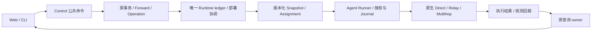

# 转发框架诊断与后续开发路线

日期：2026-10-21（Asia/Shanghai）。状态：源码诊断与开发提案。
本轮只修改文档，未实现新功能、改变公共契约或执行验收。

## 1. 已确认的方向

交付以转发为中心、可维护、贡献者容易参与的完整 TuneX 产品。后续用途访谈已将
最终用户目标明确为多用户自助接入私有机器、使用管理员授权资源、自由组合 TCP／UDP
线路，并保留必要探测、监控与故障定位。完整使用流程、当前源码差异与产品优先级以
[产品需求基线](product-requirements-and-gap-analysis-2026-10-21.md)为准。

本文保留框架诊断与贡献路径，主要面向懂 Go、尚不了解 TuneX 的源码贡献者；涉及
Control 时提供必要的 TypeScript 与事务说明。开发者体验是支撑产品的工程要求。

- 主线为自研原生引擎，覆盖单目标 TCP／UDP、节点间中继与既有多跳。
- 扩展通过可信源码 PR 和编译期集成进入产品。
- Forwardx 用于学习执行管理与产品闭环；参考 TuneX 用于学习部件职责和资源组织。
- 参考项目不成为导入、构建、运行或部署依赖；本路线排除第三方执行后端兼容接入。
- 先诊断框架，再依据真实缺口优化，之后选择一个真实扩展检验贡献路径。

完整产品优先于独立引擎库。用途访谈已确认资源限制包含端口、带宽与流量的需求，
具体计量／执行语义仍需设计；导入器尚未选定。首个源码切片和实现授权以产品基线
及后续任务为准，早先扩展案例的讨论不自行确定优先级或开放实施。

## 2. 证据与授权范围

| 对象 | 本地目录 | 读取修订 |
| --- | --- | --- |
| 当前 TuneX-Core | `D:/my-project/TuneX-Core` | `01b264509a0aa50a261b8cb2cf0b866c282f9818`，附工作区文档修改 |
| Forwardx | `D:/my-project/references/Forwardx` | `1b9b80cc3cacde3603ad0e9b8c831baa4a7fc41b` |
| 参考 TuneX | `D:/my-project/references/TuneX` | `5a5a1f19d44ed82889d7bec981939059e18fe4a0` |

分析依据是这些快照中的声明、实现和调用关系，没有运行参考程序、比较性能或认证
原程序兼容。详细参考事实与风险见[参考学习记录](forwarding-reference-study-2026-10-21.md)。

B 对冻结公共契约已有接受记录，源码为 `e208a3abf17129b0c2898ba2022c69f60f45445a`，
实际测试合并修订为 `c3ce8a67b901f61234b4116190409854818cb6c7`。准确范围与结果见
[验证记录](foundation-verification-2026-10-19.md)。这次阅读没有验证当前 HEAD 或文档工作区。
旧架构文档中的 source-only/unverified 表述须按各自日期理解，不能据此否定后来的
限定接受，也不能把 B 的历史通过扩展到后续变更、独立物理主机或发行。

本轮六项说明：

1. 层级：阅读 L0–L3，修改框架诊断、学习记录和文档入口。
2. 公共接口：Forward 命令／执行准备、Path／Ingress、Runtime、执行宿主、查询及观测。
3. 地基：本轮不修改实现；后续如需改变冻结契约，先记录 FR 及兼容影响。
4. 契约：本轮没有新增或改变公共接口、协议、数据结构与运行语义。
5. 验收：已阅读源码与文档；本文件的运行验收全部为计划，未执行检查或实验。
6. 并发影响：保留现有修改；不启动产品模块开发，不修改参考仓库及共享组合源码。

## 3. 当前框架：系统链路与源码分层

这两个角度不能互相替代。Web／Control／Agent 回答部署与执行在哪里；L0–L3 回答
职责属于谁、源代码允许依赖谁。Agent 不是单独一层，Control 也不全是 L3。

图中箭头表示业务处理过程，不是源码导入许可；恢复由原 Runtime、Runner 及各自
持久化 owner 贯穿处理，不能另建一个中心协调器接管全部状态。

| 层级 | 当前职责与入口 | 后续开发约束 |
| --- | --- | --- |
| L0 | `@tunex/core` 的 Forward v1；`kernel/public.ts` 的最小运行决策 | 保持纯领域与现有不变量；展示字段和后端选项不直接进入 Core |
| L1 | `apps/control/src/framework/public.ts`；Agent `executionhost` 等通用端口与机制 | 复用 Runtime、事务、生命周期、公共错误与日志；通过注入接入外层实现 |
| L2 | compatibility、存储、原生协议、`executiondriver`／`nativeexecution` 及实际平台实现 | 消化平台／格式／wire 差异；不把原生类型倒灌通用端口 |
| L3 | Forward、Path、Ingress、Transport、查询、遥测和 Web 产品 owners | 使用公共入口；跨 owner 原子工作加入原事务，不直接写别人的表 |

完整边界以[四层说明](../architecture/foundation-layers-v1.md)、
[边界清单](../architecture/foundation-boundaries-v1.json)和
[候选索引](../architecture/foundation-candidate-index-v1.md)为准。目录名称、接口名称或
一次提取本身不能证明整包已完成分层，更不能据此绕过已有混合实现的分类记录。

## 4. 从配置到恢复的真实接入地图

下表 Control 的 `modules/` 路径相对 `apps/control/src/`；其他路径相对仓库根目录。
阶段之间保留原 owner 的责任，没有“注册一个 Go driver 就自动贯通”的入口。

| 阶段 | 当前公共入口与实际链路 | 贡献者需要处理的事项 |
| --- | --- | --- |
| 配置与意图 | `modules/forward-owner/public.ts` 的 `ForwardCommandApi`；现有 API／Web 调用；格式输入可用 L1 `ForwardImportAdapter` | 先分清新增产品输入还是新增执行语义；纯格式转换不发命令、不获得执行权限 |
| 接受命令 | `forward-owner/commands.ts` 的 `ForwardCommands.create`／原更新删除重试；调用授权、幂等、执行准备、Forward store、Operation 与容量端口 | 身份、expectedRevision、资源和回执留在原事务；202 表示接受，不能表示已经运行 |
| 选择与准备 | `ForwardCommandExecutor` → `ForwardExecutionRegistry` → `nativeForwardAdapters` | `nativeDriverFor` 按已解析 path 的 via 数选择 Direct／Relay／Multihop；adapter 加入调用者 Tx |
| 编译与发布 | 原 native compiler／Relay 计划、L1 RuntimeHost／ledger；`SnapshotAssignmentRegistry` 和 `RelayAssignmentSource` 汇合贡献项 | 精确绑定节点、角色、锁定 Profile、修订和资源；聚合器不替代最终 Snapshot/schema 校验 |
| 协议与准入 | `@tunex/contracts/runtime`、Agent `adp3` 及原 Runner 入口 | catalog、schema、TS／Go 解析、能力与持久读者须一致；未知输入保持明确拒绝 |
| 生命周期 | `agent/internal/executionhost/driver.go` → typed `executiondriver` → `nativeexecution` → `forward`／`relay` | 实现支持的 Start／Replace／Phase／Drain／Close／Probe；持续遵守原授权检查和资源上界 |
| 执行回报 | 原 Runner／Runtime 的结果路径，`modules/control-query-owner/public.ts` 的 `ControlDetailApi` 与诊断 API | 区分 Accepted、Applied、监听、Probe 与 cleanup；带原身份、修订、来源与时效 |
| 指标 | `payloadstats` → Runner `forward_counters.go`／`forward_telemetry.go` → 原 telemetry owner | 沿既有 epoch／实例身份、序列和缺测语义扩展；统计展示不自动成为可靠计费 |
| 故障与恢复 | 原 Runner／authority／Journal／lease／fence；Runtime 原对账、资源退役和 Recovery owners | 处理旧世代、撤权、未知结果和清理；重启不清历史，不按旧配置盲目恢复执行 |

能力目录是声明；节点事实、当前策略、Control 开关和实际可执行状态是不同证据。
`native-driver-owner/contracts.ts` 已分别暴露这些概念，新增产品表达应复用其来源。

### 4.1 原生实现已有的基础

- Direct 已调用自己的 Go TCP／UDP 实现，并支持原有授权与替换路径。
- Relay 有连接／会话、凭据、阶段与排空；Multihop 复用有界 stream／UDP 实现，
  保留独立校验和 wire 握手。
- `Policy` 已有 connect timeout、UDP idle timeout、TCP 连接数、UDP 会话数等边界。
- `payloadstats` 已有流量、TCP／UDP 事件和 epoch；Runner 已绑定实例身份并保留
  有界终态尾部。后续工作不能将这些重新列为待从零建设。
- Path 模板／组／精确绑定／发布、Ingress 组／迁移以及 C1–C4/D2 的产品入口已有源码。
  是否完善和通过相应修订验收，须分别查看其记录。

### 4.2 兼容入口与 owner 记账

`modules/runtime/snapshot-assignments.ts` 仍转出 Forward owner 的实现；Agent
`control/execution_driver_adapter.go` 保留旧 private driver 与 public typed host 的桥接。
这些是现存调用者的兼容安排，不能复制成新框架或当作新增模块访问 private 的许可。

后续每次调整都记录：公共契约 → 真实 owner → provider／默认绑定 → 消费者 →
旧兼容入口 → 保留或移除条件。删除桥接必须先处理其消费者与兼容证据；本轮不删除。

## 5. 诊断：已有、缺口与优化处置

| 编号 | 源码／文档依据 | 缺口性质与判断 | 处置 |
| --- | --- | --- | --- |
| G1 | 已有四层、公共 ports、原 Runtime／Runner 和原生执行实现 | 基础已经具备；缺少面向新贡献者的简明全链路入口 | 以本文地图连接现有 owner 文档，不重建 Core 或通用引擎宿主 |
| G2 | `nativeDriverFor` 固定映射三个 driver；registry 与 catalog 对齐；schema／Snapshot 有显式约束 | 扩展范围有意封闭。新增执行语义确需跨层变更，但仅凭此不能认定错误耦合 | 给出变更清单；由真实扩展检验哪些绑定可保持、哪些确有必要改 |
| G3 | `examples/foundation-extension/module.ts` 只提供 preview，输出 `executionAuthorized:false` | 已有冻结只读示例；尚未展示一次新增原生执行能力的完整贡献过程 | 补贡献说明，并在后续选定功能中形成纵向范例；不贬低 B 已接受的示例范围 |
| G4 | Direct TCP／UDP 的 Replace／Drain 不同；Relay／Multihop 使用不同阶段；I/O 授权包装有相近实现 | 生命周期不能仅靠同名方法推定等价；既有复用、真实重复与必要差异并存 | 本节给出初版行为表；保留必要差异，分别评估错误解释与私有机制复用 |
| G5 | 修订前 `framework-integration-v1.md` 与 `foundation-layers-v1.md` 入口保留早期“未验收／门禁关闭”表述；候选索引已记录 B | 文档时序容易误读，会影响贡献者对可用入口的判断 | 本轮已校正两处入口，保留历史范围，链接准确修订与接受边界 |
| G6 | 已有 C1/C2/C3/C4/D2 源码和查询；D1 负载方案未执行 | 部分产品体验已有；缺的是任务范围内的完善与相应环境证据，不能笼统写“功能缺失” | 对照参考补具体使用断点，复用既有 API；独立取得负载／长稳／物理主机证据 |

在本轮阅读的 Direct／Policy 路径中，未见可配置的 TCP 双向 idle timeout 或逐规则
字节速率策略。这是有限范围的候选能力观察，不是完整功能普查，也不据此决定先做
限速。它们涉及的配置、更新、旧连接与恢复语义应在选题后另行设计。

### 5.1 原生行为对照：本轮已读到的差异

此表是实现阅读结果，不是运行通过记录。路径均相对 `agent/internal/`。

| 维度 | Direct TCP | Direct UDP | Relay／Multihop | 判断与源码 |
| --- | --- | --- | --- | --- |
| 配置变化触发 | 原 Runner 比较 ConfigDigest、DeploymentGeneration、BindingFence | 同左 | 同左；阶段另走 phase 路径 | 已有共同执行身份，不需要新建配置 hash 系统；`control/runner.go` |
| 原地替换 | 相同绑定且仍持有 listener slot 时创建新实例，共享 permits，旧连接留在旧实例 | 相同绑定切换 slot 后调用旧实例 Close，关闭旧会话 | 当前 descriptor 未提供 Replace；由原 Runner 管理变更生命周期 | 必须分别声明已有连接影响；`forward/tcp.go:104`、`forward/udp.go:151`、`nativeexecution/relay.go` |
| 阶段与排空 | descriptor 仅 active；Drain 停止当前实例接入，保留已接受连接 | Drain 直接 Close | prepared／active／draining；TCP 停止接入并设 drainUntil，UDP 直接 Close | 不承诺统一无中断；Runner 保留原 ticket／截止／清理；`forward/tcp.go:240`、`forward/udp.go:401`、`relay/engine.go:295` |
| 持续授权 | 读前、读后与写前检查回调；截止后的关闭由调用者管理 | 收包／会话 I/O 和拨号路径检查授权 | I/O 检查外，还校验凭据／peer／排空截止并有 watch | 安全 owner 不可合并到新引擎；`forward/authorization.go`、`forward/udp.go`、`relay/engine.go` |
| nil 回调兼容 | 私有 gate 的 nil 目前返回允许 | 复用同一个私有 gate | Prepare 拒绝 nil，SetAuthorization(nil) 停止 engine | 这是不同内部前提，不能提取 helper 时统一默认值；实际执行仍须经过原 Runner 准入 |
| 资源预算 | 实例与 node permits；替换继承实例 permits | 会话数量、node permits 和有界包队列 | engine maximum、profile node 限制及原 Relay 计数机制 | 预算作用域需明确；各自上限不能相加或推定为统一全节点总上限 |
| 错误分类 | Direct classifier 对收到的错误统一给出 PORT_IN_USE、可重试 | 与 TCP 共用 Direct classifier | 按配置、授权、资源、下游等前缀区分拒绝与重试 | 值得优先评估解释精度；不是本轮已复现故障；`nativeexecution/direct.go:33`、`nativeexecution/relay.go` 的 ClassifyRelay |
| I/O 与计数复用 | authorizedReader／Writer、payloadWriter 和双向 io.Copy | 自有 datagram／association 流程；同用 payloadstats | TCP 有相近 gateReader／Writer／payloadWriter 和 io.Copy；Multihop transit 另有 frame bridge | payloadstats、egress、Relay／Multihop 已复用；流包装有复用候选，UDP／frame 不能直接套 TCP 模型 |

Runner 在原地替换失败后会将旧实例转入原排空流程，再尝试启动新实例；这条既有
路径不承诺“失败自动恢复原配置”。参考项目的回滚机制只用于审视产品需要说明什么，
不能直接改变当前授权、世代与失败语义。详见 `control/runner.go:582` 附近。

### 5.2 从行为表导出的优化优先级

1. **先写清更新与生命周期语义。** 将 TCP 旧连接、UDP 会话失效、Relay 阶段、
   nil 兼容前提和替换失败结果纳入贡献说明、能力说明与对应验收病例。此项已能确定
   有必要做；不能用统一方法名掩盖行为差异。
2. **评估错误解释。** 顺原 Runner 的 start／replace／phase 到 classifier 和查询
   消费者列出可达错误，确认 Direct 的粗分类是否会误导状态或重试。需要改变公开
   错误／重试语义时先记录 FR 与迁移，不能当成无兼容影响的文案调整。
3. **再评估小范围 I/O 机制复用。** `forward/authorization.go` 与 Relay 的 gate
   reader／writer 都有读前后、写前检查；计数包装也相近。可研究 owner-independent
   私有 helper，但必须保留 nil、错误返回次序、半关闭、字节计数位置与原调用者责任。
   若为此需要泛化全部 engine、迁走 Runner 权威或统一协议差异，则保留现状。

这些是可评审的下一任务候选，不是本轮已实施的重构。暂无测量证据支持重建调度器、
改换网络库或声称上述提取可以提高吞吐量。

## 6. 两个参考项目分别帮助优化什么

| 参考机制与定位 | 当前可吸收的原则 | 落点与取舍 |
| --- | --- | --- |
| Forwardx `tool_inventory.go`、规则状态说明 | 声明、工具发现、应用确认、监听与健康分开解释 | 完善现有能力／状态读模型；可执行文件存在不是当前原生执行就绪证据 |
| Forwardx `managed_configs.go`、`actions.go` | 明确配置身份、分阶段应用、失败结果与恢复条件 | 检查原生配置更新和生命周期契约；不引入外部进程后端 |
| Forwardx `main.go` 的串行快照；参考 TuneX 周期生成／hash 去重 | 区分期望快照、唤醒与命令历史 | D1 取得基线后再决定合并与调度优化；不合并撤权、回执和受保护历史 |
| 参考 TuneX `gostcfg` 的 listener／handler／chain／dialer／connector／forwarder | 用职责分解定位扩展点，避免一处函数接管所有协议 | 先画现有原生调用图，按真实重复提取；不直接复制任意协议组合模型 |
| 参考 TuneX NodeGroup／Tunnel／TunnelChain；Forwardx 资源复用 | 用户按入口、出口和路径理解配置，并预览影响 | 完善现有 Path／Ingress／Transport 选择与诊断；不将组等同于共享物理链路或自动路由 |
| Forwardx pending 报告／身份／事务去重；参考 TuneX 用量倍率 | 明确观测丢失与重放，解释实际字节和业务消耗 | 先复用原 telemetry owner；可靠计量、套餐、计费各自定义契约 |

反向借鉴同样重要：参考 TuneX 的 `sameDefinition` 只比较部分字段，不能沿用为
完整更新判定；hash 去重不能证明每个节点已经应用；部分错误仅写日志不能替代逐项
结果。Forwardx 的大型心跳协调入口和参考 TuneX 集中式业务编译也不作为当前 owner
划分的重构模板。具体事实、推断影响和待验证场景见参考学习记录。

## 7. 后续顺序与明确交付

### R1：讲清当前框架与贡献路径

本轮交付：现状图、全链路入口、G1–G6、原生行为初表、参考取舍与路线，并修正文档入口时序。
这是诊断交付，不代表一份新增原生能力的可运行教程已经完成。

下一任务将 5.1 初表细化为贡献者可用的行为说明，补齐部分启动清理、完整错误可达
路径及持久读者／恢复映射。每项标明 owner、当前实现、差异理由及证据状态，按
5.2 的顺序形成具体变更范围，不能把诊断表当成所有边界均已验收。

退出条件：新贡献者能定位 Go 执行与必要 Control 改动，判断问题属于文档、接口、
实现还是验证缺口；任何建议重构均能指向具体重复或错误依赖。

### R2：按真实问题完善原生扩展边界

逐项处置 R1 行为表：已统一的保持；协议差异明确保留；有重复才提取公共机制；
无法通过现有端口表达的需求才提出最小扩展。不得预设必须重写 driver registry、
移出所有 native 分支，或另建一个管理授权、生命周期与恢复的总引擎。

交付公共／private 变更、完整 owner 调用链、默认／兼容绑定、迁移和对应验收计划。
改变冻结契约或语义时先记录 FR，注明已有持续源码授权及破坏性源行为；新增验收
病例进入相应 readiness／契约记录。源码完成后冻结，集中验证须另获授权。

退出条件：每个变更均说明解决的实际问题；依赖方向、事务与执行权威保持明确。
未发现需要重构的地方可以记录结论，不以目录移动数量衡量进度。

### R3：用一个真实原生扩展验证贡献方式

R1/R2 结论形成后，再按用户价值、代表性和跨层影响选择功能。候选可以是现有
原生能力的策略增强或受限传输扩展；限速尚为候选，不能自动升级为本轮任务。

贡献范例覆盖：需求 → 层级与公共契约 → 配置／版本 → Control 原命令／编译 →
Agent 执行 → 状态／指标 → 更新与恢复 → 准确修订验收 → 集成说明。
范例基于生产源码，不另写一套示例引擎；必要时既有目录局部扩展，不强造新模块。

退出条件：至少一个有用能力经过这条路径，贡献者能依文档理解改动与复现规定验证；
不能把“能够注册”或“preview 返回成功”作为新执行能力完成。

### R4：完善资源使用、诊断与运行质量

复用既有 C1–C4/D2：从选择 Node／Path／Transport，到预检、精确引用、执行状态、
失败和条件补偿，逐个补齐使用断点。每项说明来源、时效、作用范围、拒绝原因与
已有连接影响，不能用运行数量推定端到端健康。

D1 按[负载方案](load-baseline-2026-10-20.md)测量页面请求扇出、数据库查询、任务
积压、连接／会话与内存上界。测量可以贯穿 R2/R3 获授权后的验收阶段；有瓶颈才
优化调度、快照合并与慢消费者，不能为推进路线先造新的调度平台。

退出条件：相应功能有准确修订证据，负载／长稳与真实环境边界明确。独立物理主机、
独立 Responder 交付、镜像和正式发行继续独立记账。

## 8. 后续验收与未解决的兼容问题

以下均为计划，本轮没有新增测试／CI 工具，也没有执行检查、构建或实验。

| 验收主题 | 必须说明或验证的事项 |
| --- | --- |
| 配置身份与完整更新 | 保持名称／端口，只改目标、地址、路径、锁定 Profile、凭据或策略，确认识别与执行效果 |
| 生命周期 | 逐 driver 声明支持的替换／阶段、停止新接入、旧连接排空、到期关闭、重复清理与部分启动失败 |
| 原事务与资源 | 授权、幂等、CAS、资源预留、Operation 和回执保持原 owner；跨模块原子工作加入原 Tx |
| 能力与拒绝 | 声明存在但节点未知／不支持／过期／策略拒绝时，影响当前实例前明确处理，不静默降级 |
| 执行权威与恢复 | 撤权、租约截止、Agent 崩溃、旧世代重放、fence、Journal 和未知结果；清理义务不因关 flag 消失 |
| 观测 | 实例／epoch／序列、重发乱序、拓扑变化、终态尾部、coverage／gap／stale 和精确 uint64；缺测不补零 |
| 贡献与兼容 | 当前公共入口、实际 provider、旧别名／private 桥、消费者、版本迁移和可用范例对应同一冻结修订 |
| 资源与部署 | 连接／会话／等待／字节上界、关闭与饱和；负载／长稳；独立物理主机单列证据 |

目前尚未选择新增执行语义，因此不能提前宣称既有 schema、Control 映射、Agent
持久读者和恢复均可无变更复用。应在 R3 选题前明确所需兼容维度及 FR 范围。

获授权后的本地验证仅按任务允许的静态范围执行；功能、MySQL、网络、容器、浏览器
和故障验收属于 GitHub Actions，记录准确源码 SHA、实际测试修订、环境、跳过和
剩余条件。历史绿灯不能验证后续修改，同机环境不能替代独立物理主机。

## 9. 暂不纳入主线

| 方向 | 当前决定 |
| --- | --- |
| Realm／GOST 等第三方执行后端 | 排除本路线；保留参考学习，不设后续接入阶段 |
| 独立引擎 SDK、运行时插件、第三方代码隔离 | 先完成可贡献的产品及可信编译期扩展 |
| 单 Forward 多目标、L7、透明／内核转发 | 超出现有范围；需要独立价值判断、语义与版本提案 |
| 自动故障转移／路由 | 固定路径与人工切换经验不替代自动决策契约和验收 |
| 套餐／计费／支付、通用导入平台 | 不作为本轮首个功能；分别明确 owner、事务与口径后立项 |

本路线补充[现行开发执行方案](development-plan.md)。R1 → R2 → R3 → R4 表示依赖
顺序，不是同时开工或已获所有实施／验证／提交授权。当前交付为 R1 诊断文档；
用途访谈后的具体顺序以产品需求基线的 P1–P5 为准：先收敛归属、授权和可见性，
再推进自助组线、资源限制及监控诊断。R2 原生扩展优化按实际需要进入对应产品切片，
不再把独立扩展范例作为最终用户流程的默认前置条件。
