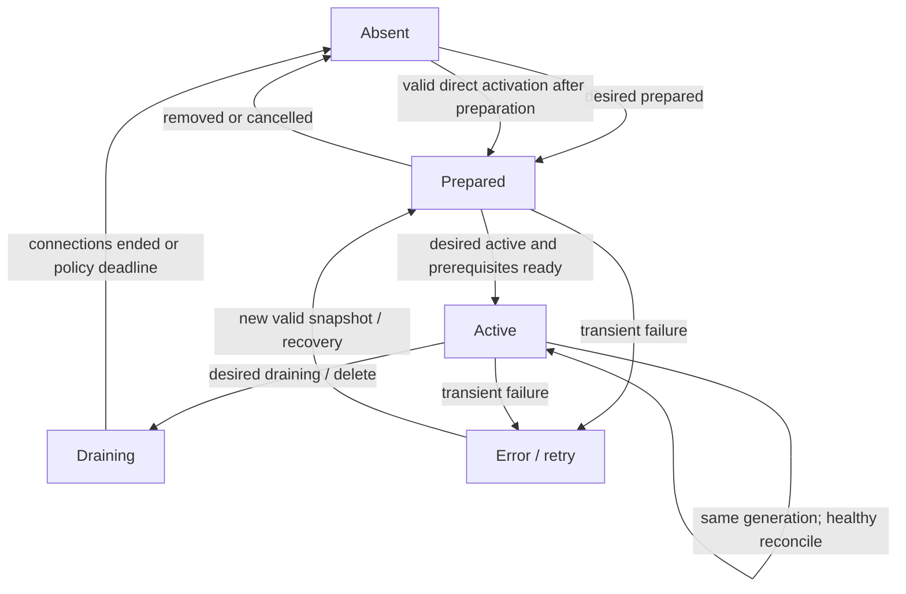

# Runtime Controller & Go Agent v1

**Accepted for implementation.** Describes runtime ownership and behavior; the old V2 service implementations are not a compatibility requirement.

## 1. Internal modules

### Control / Runtime

- `Forwarding Application`: own CRUD and user intent, permission checks, CAS, immutable revisions, durable Operation.
- `Planner`: compile Forward + authorized capabilities + optional resolved path/Transport Profile into a valid Deployment with protocol-specific per-node Assignments; **no IO** inside deterministic plan calculation.
- `Port Allocator`: exclusively own logical reservations keyed by `nodeId/protocol/port`; DB transaction/constraints prevent two active owners. Fencing increases when owner switches.
- `Deployment Controller`: choose dependency order and prepare/activate/drain phases, never directly operate sockets.
- `Snapshot Store`: publish complete per-node desired state with monotonic generation allocated transactionally. Snapshot must be reproducible solely from durable data.
- `Reconciler`: compare desired vs report/expired observation, resume pending Operations and repair drift with bounded retries.
- `Agent Adapter`: mutually authenticated HTTPS endpoints, schema and report validation.

### Go Agent

- `Control Engine`: credential identity, hello/snapshot/report, cache integrity, validation and backoff.
- `Assignment Manager`: generation comparison, local diff, crash-safe state journal, reconciliation and phase state machine.
- `Ownership Manager`: exclusive binding slots, generation fences, resource cleanup, port protection.
- `Forward Engine`: TCP accept/dial/copy, UDP session tables/timeouts, limits and drain.
- `Transport Drivers`: statically registered native/direct, later native/relay and explicit encrypted profiles. Driver contracts describe ability and lifecycle, not arbitrary remote code execution.
- `Reporter`: bounded and deduplicated condition/metrics reports.

## 2. One transaction boundary per important intent

On create/update/delete Application atomically: (a) assert scope and expected Forward Revision, (b) reserve/adjust logical resources, (c) commit desired Forward or tombstone, (d) create Operation/outbox or discoverable pending work. HTTP returns Forward/Operation IDs only after database commit.

Worker scans persisted pending work even if no Redis message arrives. All jobs have a DB claim/lease token and crash recovery rules; a stale Worker cannot publish a new snapshot based on an expired ownership claim. Concurrent reconcilers use transaction CAS and idempotency keys.

## 3. Two-phase staged execution, not a distributed transaction

Runtime phases are internal states such as:

`pending -> preparing -> activating -> applied -> (updating / draining / removed)`

Preparation per role:
- `direct`: validate local driver and prerequisites, stage resource plan; do not claim external listener available until activation binds.
- `egress`: stage target/transport egress and authentication prerequisites; local ready means its required resources are staged, not guaranteed target reachable.
- `relay`: prepare upstream/downstream according to driver dependency plan.
- `ingress`: stage ability to reach prepared downstream, then activate actual client-facing listener.

Activate only after all required downstream dependencies reached the correct generation and acceptable freshness; publish ingress `phase=active` in a newer node snapshot. A partially prepared deployment must remain recoverable, and timeouts/errors must be reported to user. Full rollback may be impossible; controller must keep a durable cleanup task for any orphaned assignment.

## 4. Local Agent state machine

Idempotency is mandatory. The local state machine is guarded by an assignment generation and the **physical slot fence**, not just a phase enum. Snapshot acceptance is atomic on disk, but resource transitions are not atomic across hosts; persist partial results and re-run convergence.

`ready` means applied configuration and listener/transport prerequisites are demonstrably active; it does not automatically mean end-to-end customer target health. Observations older than freshness policy degrade to unknown.

## 5. TCP/UDP execution constraints

TCP: bounded connect timeout, bounded buffers and goroutines, half-close correctness, cancellation, accounting exactly once per stream when measurable, consistent target errors. A route update should direct **new** streams to new generation while permitting established ones to drain when resource policy allows.

UDP: maintain scoped session/association table and idle expiry, anti-amplification/resource limits, correct return routing, NAT behavior per driver; replacing upstream paths may invalidate sessions. Do not promise transparent failover of arbitrary UDP flows.

Listen addresses: actual IP dual-stack binding behavior, existing local processes and namespace conflicts are authoritative. V1 conservatively reserves `node/protocol/port` regardless of specific bind IP; Agent checks the exact real socket result. No `SO_REUSEPORT` feature in baseline.

Target security: enforce per-node outbound network policy after DNS resolution and before actual connect; unsafe host rebinding or permission boundary bypass must not be accepted. No automatic plaintext fallback for secure profiles.

## 6. Port ownership & fencing

One logical physical slot is `(nodeId, tcp|udp, port)`. Its owner has a monotonically increasing fence. Reservation owner must match Forward and Deployment/Assignment; local Agent rejects stale fence on bind/swap/release. A slow shutdown callback cannot free a newly assigned listener. The DB allocator and Agent must both preserve high-water markers through restart.

An observed `PORT_IN_USE` from an external process does not erase the desired Forward; persist an actionable failure. The DB allocator should release reservations only on safe delete completion/expiry policy, not immediately on user request.

## 7. Health, lease and offline policy

Agent may continue known valid running assignments while Control is unreachable **only until the enforced authorization lease expires**. Node credential revocation may not be immediately observable offline. Local snapshot cache must be integrity protected and valid for this Node; private runtime secrets require a separate protected storage path with explicit expiry/rotation.

An Agent crash followed by restart must restore durable generation/fence state first, then restore only currently authorized assignments, report new bootId and reconcile with full Snapshot. Wall-clock rollback, corrupted caches and lost fence persistence fail safe; they do not reset generations to zero.

## 8. Runtime extension contracts

Transport drivers implement capability declaration, schema-validated config, prepare, activate, status, drain and cleanup in Go. Their identities and security guarantees are versioned; Controller uses driver capability facts via a stable module port. The initial driver is `native.direct.v1`; future `native.relay.v1` and `tst.v1` are distinct modules and are not silently enabled. A Link pool, if added, remains a Transport-internal implementation resource; Forward Core does not acquire Link identities.

## 9. Non-negotiable failure scenarios

- Prepared downstream reports after it was superseded: ignore for new deployment.
- Ingress activates while egress is stale: forbidden.
- Agent loses network after accepting Snapshot: continue only within lease, reconcile on reconnect.
- Worker dies between database commit and Redis publish: scanner discovers work.
- New Forward inherits deleted Forward's port: old fence can neither rebind nor release new owner's resource.
- Snapshot report arrives out of order: never regress applied state.
- Secure profile misconfiguration: refuse deployment, no plaintext downgrade.

