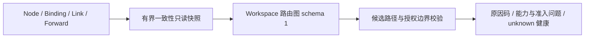

# TuneX V2.3 智能链路与高级路由

按用户提供的 V2.1–V3.0 后续方案推进；先交付 R1 拓扑/路由模型，再做授权探测、
策略选择、故障切换与多跳执行。V2.2 自动验收已收口，真机部署继续延后统一验收。

## 工作包状态

| 工作包 | 当前交付 | 下一步 |
| --- | --- | --- |
| R1 拓扑模型 | Workspace 统一有向图、Native/TST 并行边、节点能力/连接/生命周期、成本/质量/健康契约、候选策略校验、只读 API | 根据 R2 观测接入质量事实；策略持久化随 R3 实现 |
| R2 健康与探测 | Native TCP/both 的目标 TCP 连接观测、授权/预算/身份/时效、只读结果查询；节点/边健康仍 unknown | TST 目标绑定探测、独立 RTT/丢包/TLS/UDP 测量、授权载体质量 |
| R3 路由策略 | priority/weighted 候选意图、正权重、优先级与跳数输入契约；不执行选路 | 持久策略、解释性选择、健康阈值、冷却和抖动抑制 |
| R4 故障切换 | 预览绑定现有 Forward、revision、入口和授权出口；不迁移会话 | 新连接迁移、失败恢复、已有 TCP/UDP 会话中断语义 |
| R5 多跳与负载均衡 | 图校验支持最多 3 个物理节点；环路、混合载体、断边拒绝；多边路径标记执行不可用 | 每 hop 授权/身份、TTL、配额/计量归属和逐项执行门禁 |

已交付 R1 基础与 R2 首轮目标观测，不宣称 V2.3 整体完成。策略预览没有调度器消费路径，
`execution_enabled` 固定为 false；开关只控制查询/预览入口。

## R1 设计决策

图是既有数据库事实的计算视图，不另建节点、Link、业务目标或 desired state。
`NodeBinding` 表达 Native 节点间绑定，`LinkResource/LinkVersion` 表达 TST 有向载体。
`Tunnel` 的统一 Forward 记录提供入口、已授权出口、协议、载体、revision 与业务状态。
已有 `/api/forwards/:id/topology` 的诊断视图保持原契约；本图供后续 Workspace 路由规划。



查询在 MySQL RepeatableRead 事务内进行。每次最多 256 个节点、512 个绑定、256 个
Link、500 个 Forward；读取上限加一判断溢出，溢出返回 `topology_limit_exceeded`，
不提供可能漏边的部分图。只投影本 Workspace 拥有的节点，不通过共享组授权或联邦
资源扩展路径。未来跨空间/跨 Panel 能力必须另行设计授权，不能利用预览绕行。

每条边持有稳定 ID（`binding:<id>` 或 `link:<id>`）、方向、载体与来源版本，同一对
节点的 Native/TST 边独立。Link 配置使用现有严格端点 schema 解析，最新存储版本
必须与 desired_version 一致；缺失、旧载体、外部节点或坏配置产生 notice，不猜测端点。
Forward 引用的 Link 必须与其当前端点一致；Native 目标池必须属于已授权出口、启用
且有正权重 active 目标。无效/历史协议、缺失 revision、已存 middle/federation 等
当前未适配形状以 issues 返回，不能被预览解释成可运行 TCP。

能力事实复用既有 manifest/准入解析器，使用当前凭据之后、非未来且 90 秒窗口内
的上报。坏清单标记 invalid，缺失/过期区分 unknown/stale；未上报 manifest 不在本图
推断 Native baseline 能力。TST 协议支持需显式 `forward.link.tst.v1` 广告。
节点连接态与生命周期分别展示，仍不构成业务可达证明。

节点/边尚未进行独立探测，因此健康均为 `unknown`，RTT、丢包和握手成功率均为 null，
成本为 null/unconfigured。不存在把缺失测量填成零的排名。后续需要扩展观测 schema，
明确探测来源与授权，再把新鲜观测交给 R3；图结构本身不发送网络探测。

## API 与权限

默认 `TUNEX_ROUTING_ENABLED=false`，只有精确值 `true` 开放拓扑/预览。
这些端点挂载在现有全局认证、CSRF、审计和限流之后。

| API | 权限与行为 |
| --- | --- |
| GET `/api/routing/capabilities` | forward:read + node:read；开关关闭时仍可发现 schema、限制与功能状态，列明后续执行能力为 false |
| GET `/api/routing/topology` | forward:read + node:read；返回 schema 1 图和 SHA256 digest，禁用时 409 |
| POST `/api/routing/preview` | forward:read + node:read + node:use；只校验意图，不保存策略、分配端口、写 revision 或下发命令 |

所有路由内响应包含 `Cache-Control: no-store`。返回值使用封闭 DTO，不返回凭据 hash、
原始 report/config、载体端口、私钥、证书或目标地址。ORM 错误只返回 `routing_unavailable`。
全局认证在进入路由前拒绝未登录请求；Workspace 凭证继续使用既有个人/团队空间规则。

预览输入的 `schema_version=1`、`forward_id`、`expected_revision` 与 `topology_digest`
绑定当前快照；`strategy` 只接受 priority/weighted；最多 16 个候选，每个提供唯一 ID、
有序 edge_ids、0–65535 的 priority、1–1000 的 weight 和最多 3 个物理节点的 hop_limit。
候选 ID/路径重复、未知字段与协议版本被拒绝。实际请求字节限 32 KiB，对无长度头、
伪造较小 Content-Length 和流式请求均执行限制。

预览校验连续方向、Workspace 内边/节点、无环、跳数、节点角色、相同载体及已有
Forward 的入口/授权出口。将出口挪到另一个节点不能沿用原目标授权。
结构错误返回候选 `valid=false` 和 reasons；能力、维护/离线及多跳执行问题另列
admission_issues。结构有效不表示业务健康，也不是 dispatch 授权。不会选择最高优先级
路径或执行权重轮询；这些属于 R3。

| 失败 | HTTP / 行为 |
| --- | --- |
| 未登录、Workspace/资源权限不足 | 现有 401/403/404 授权语义；处理器不读取拓扑 |
| invalid_input / request_too_large | 400 / 413；读取数据库前拒绝 |
| routing_disabled | 409；不读取拓扑，能力发现除外 |
| forward_not_found | 404；不泄露其他 Workspace 的 Forward |
| topology_conflict / revision_conflict | 409；调用方重新查询，不自动基于旧意图重算 |
| forward_topology_unavailable | 409；需修复 Forward 的 issues |
| topology_limit_exceeded | 422；超出当前完整快照容量 |
| routing_unavailable / topology_scope_invalid | 503；不回显内部数据库/凭据细节 |

## 验证与复现

```bash
cd backend
bunx tsc --noEmit
bun test src/domain/routing/__tests__/routing.test.ts src/routes/__tests__/routing.test.ts
bun run test:unit
# 只允许 loopback tunex_ci 或 tunex_v23_test，需已迁移 MySQL 和隔离 Redis。
TUNEX_DB_TEST=1 node --experimental-transform-types --test tests/routing-topology.test.mjs
```

本机 Windows 已运行 typecheck、schema validate、25 项模型/HTTP 测试和全量 3,210 项
后端测试（19,299 次断言、0 失败）。首次全量因 PATH 缺 sh/grep 失败 12 项；补齐已
安装的 Git usr/bin 与 bin 后复验通过，失败日志保留。独立 `tunex_v23_test` 从空库
应用既有迁移，真实认证、MySQL/Redis/HTTP 集成 7 项通过、0 skipped，包含只读
前后 Forward/revision/lease/operation/deployment 不变的断言。此处 fixture 的能力
上报是数据库测试输入，不宣称执行过 V2.3 Agent 探测或实际多跳 payload。

本机收据保存在 `scripts/integration/evidence/v2.3-r1/`（不提交 Git）。
固定源码为 `0d90619906f1bb27d994ce4ae9610a1bc5538be2`；对应
[Linux CI #38131964218](https://github.com/PaiMonCai/TuneX/actions/runs/38131964218)
全部通过。Linux 后端全量 3,210 项、19,299 次断言通过；真实数据库/HTTP 集成
131 项通过、0 skipped，其中新增路由集成 7 项。空库迁移与历史基线升级回放通过。
Agent 全量、race、fuzz、构建及 Web/运维/凭据与活跃依赖检查均通过。

同一源码的隔离容器真实链路验收通过：TST 24 PASS / 0 FAIL，Native both
37 PASS / 0 FAIL，覆盖真实 TCP/UDP payload、修改/暂停/恢复、共享规则隔离、
失败补偿、Agent 重启与确认删除。原始结果来自该运行的 `abcd-core-result` 工件，
本机副本在 `scripts/integration/evidence/v2.3-r1/core-ci-0d90619/`。
这些结果证明既有数据面的回归通过，不证明尚未开发的健康探测、选路或多跳执行。

## 数据、回退与后续依赖

本轮没有 schema/migration、Agent 帧/命令、现有业务写接口或前端 UI 变更，新增模块
只读取现有资源。全局访问审计保留原行为，不纳入“业务资源零写入”的断言。
关闭 `TUNEX_ROUTING_ENABLED` 即停止查询/预览入口；回退代码无需回退数据库迁移，
不会改变现有业务或目标配置。TST、Native both、路由执行的发布门槛保持原约束。

R2 后续继续接入 TST 绑定授权与载体质量，不扩张本轮 TCP 目标观测的证明范围。
R3/R4 需将持久意图与执行结果分离，切换前重新校验目标/节点权限、revision、能力、
配额与健康，不把本轮预览 digest 或 valid 当成操作令牌。R5 再接每 hop 身份/授权、
TTL 与完整流量归属；不能凭已有图路径宣称可运行多跳。

## R2 首轮：Native 目标连接观测

新增独立开关 `TUNEX_ROUTING_PROBES_ENABLED=false`；只有它和
`TUNEX_ROUTING_ENABLED` 都为精确 `true` 才开放探测/结果入口。能力发现分别列出
Native TCP 目标探测和仍未实现的 TST 目标观测。不开启自动/定时探测或选路。

| API | 权限与行为 |
| --- | --- |
| POST `/api/routing/probes` | forward:read + node:read + node:use；封闭输入只有 schema_version=1、forward_id、expected_revision |
| GET `/api/routing/probes/:forwardId` | forward:read + node:read；先按当前 Workspace 重新授权/校验配置，再查询缓存，不发命令 |

本轮支持 Native DIRECT/RELAY 的 tcp/both Forward，both 只测 TCP 目标段。
TST、UDP-only、旧协议、多跳、联邦配置返回 422，不静默当作普通 TCP。
Forward 必须 active、applied_revision 等于 config_revision；目标节点必须属于当前
Workspace、在线且 lifecycle=active，诊断能力需新鲜显式上报。RELAY 还要求现有
NodeBinding、目标池属于授权出口且 active，只探测 active 正权重目标。
最多 3 个目标，上限加一判断溢出，拒绝重复/无效地址与超限池，不截断覆盖范围。

目标从 MySQL RepeatableRead 的封闭投影中读取，请求不能携带 host/port、超时或采样数。
复用 `diagnose_tunnel`、现有能力准入和 pending/ACK 绑定，由 Agent 对每个目标做一次
DNS+TCP connect，不拨 Forward/载体的业务监听，不发送应用 payload。结果逐一匹配
预期目标并重建 DTO；目标地址、端口、解析 IP、凭据和错误文本都不公开。

预算由 Redis Lua 原子保留：每 Workspace 同时 1 次、每节点冷却 30 秒，Workspace
保留有 60 秒 TTL。命令等待上限 20 秒，Agent 单目标上限 5 秒、总预算 15 秒。
过慢的预算/快照等待拒绝下发；写缓存与释放保留均核对随机 token，过期写者不能
覆盖新结果或释放别人的保留。预算不足返回 429 与 Retry-After；Redis/命令失败
返回 503，不记录成网络不可达。预算按请求共享，换 Forward 或 Panel 进程不能绕过。

观测身份绑定 Workspace、Forward/revision、协议/模式、入口/目标节点、Native 绑定、
目标池/目标列表和节点当前凭据 epoch 的摘要。预算保留后、ACK 后分别重读配置；
身份变化返回 409 且不接受结果。查询再匹配身份；目标、revision、节点或凭据变化
后旧结果为 unknown，不可复用。命令已经执行时配置变更可能使该次探测作废，不能
承诺取消已发送的 TCP SYN。结果只在 Redis 保留 120 秒，服务端发起时间起 60 秒
内为 current；保留期后半段显示 stale，TTL 清除后 unknown，不持久化历史。

`connect_elapsed_ms` 的 basis 是 `dns_and_tcp_connect`，包括解析与 TCP 建连，
不是 RTT。`tcp_connect_success_rate` 是本次有 TCP 尝试的目标成功比例，不是长期
统计或 TLS 握手率；DNS 失败不纳入 TCP 成功率分母。无实际尝试、未知错误或缺失
结果不产生“全部可达”。RTT、loss_percent、TLS 成功率保持 null，UDP 和端到端
verified=false。目标状态不覆盖节点/边健康，不进入 R3 的选择或现有目标池 breaker。

本轮不新增数据库 schema、Agent 动作/帧、业务配置或 UI。关闭探测开关立即拒绝新
请求与结果查询，执行中的请求在返回前重检；已发出的诊断按自身预算结束，缓存
自然过期。关闭拓扑开关同时关闭探测入口；回退无需数据库迁移。

本机专项模型/HTTP 41 项、全量后端 3,226 项（19,428 次断言）通过；真实认证、
MySQL/Redis 集成 10 项通过、0 skipped，包含拒绝路径与原子预算验证。对应源码的
Linux 实际 Agent 测量正在验收，取得结果后补齐 SHA 和工件。
`scripts/integration/routing-probe.py` 已加入 core CI：通过正常创建/应用的
Native DIRECT/RELAY，验证真实连接、冷却、配置失效、关闭目标的 refused、实际
等待窗口后的 stale 和正常 API 删除；不手改 Ready、诊断 ACK 或缓存时钟。
