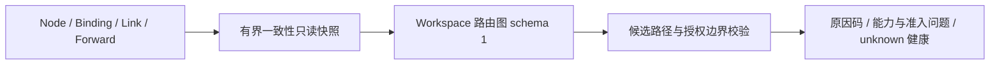

# TuneX V2.3 智能链路与高级路由

当前支持范围的自动验收已收口：同 Workspace Native TCP RELAY、固定入口/授权出口、
两至三个节点。最终功能源码为 `dee1cf96381aa79ad7119ceaf32cdfcf89316c65`；逐项功能与
性能的固定 SHA、内容 hash 和历史失败见下方验收记录。真机/WAN、UDP/TST 自动迁移及
并行路径逐连接分流不包含在该结论内，后续范围不得沿用本次通过结论。

## R4 / R5 Native TCP 交付与验收

执行器复用 Forward 的版本、配额事务与 VALIDATE → PREPARE → CUTOVER → DRAIN → CLEANUP 发布流程。
独立默认关闭开关为 `TUNEX_ROUTING_EXECUTION_ENABLED`、`TUNEX_ROUTING_MULTIHOP_ENABLED`、
`TUNEX_ROUTING_HOP_AUTH_ENABLED`；仍同时要求拓扑、探测、策略开关及独立安装密钥 `TUNEX_LINK_SEAL_KEY`。
当前执行范围是本 Workspace 的 Native TCP RELAY，两或三个不同物理节点，固定入口及获准访问目标的出口。
候选只引用已存在的相邻 Binding，不自动创建授权、不更换目标、出口或入口。
TST、Native UDP/both 的目标探测与预览继续可用；它们的策略自动迁移和多跳执行不在本轮支持范围。

每 15 秒的后台任务最多评估 32 条显式启用策略，按旧观测优先刷新授权探测，继续遵守 Workspace 单任务与源节点冷却。
同一观测或乱序观测不增加连续次数，单条已测量故障边即可证明该候选失败；缺少测量仍为 unknown。
执行事务锁定 Forward 并核对策略版本、state_version、Forward revision、当前拓扑与目标授权摘要，重新验证
创建策略的用户仍有效、成员资格及 node:use/Forward:update，选中路径仍合格、节点支持新身份能力。
失效事实拒绝写入。旧 placement failover 遇到启用的路由策略时暂停竞争。

`routing_decision` 保存执行凭据，`GET /api/routing/policies/:forwardId/history` 最多返回最近 100 条封闭记录。
receipt 包含决策 ID、Workspace/Forward/策略版本、候选/边/节点、expected/desired/applied revision、状态与原因。
事务中登记 pending 与 desired revision；只有 exact revision 的 active apply 确认才能写 confirmed。
后台重启后继续核对 pending，未知 ACK 保持 pending，失败或被新版本替代分别写 failed/superseded。
空闲评估保留最近实际执行结果，不能用“当前路径保留”覆盖已经确认的选路；只读 decision 接口解释当前阈值与保留原因。

每条相邻边使用私有 CA 签发的独立节点身份，私钥以既有 AES-256-GCM 安装密钥封存至 `routing_runtime`，
绑定 Workspace/Forward/revision。只有对应节点收到自己的身份；中间节点分别使用两边的身份。
逐跳 TLS 1.3 双向认证、精确 peer URI、证书链和独立 ALPN `tunex-routing-hop/1`，禁用 session tickets，
验证失败直接关闭连接。业务字节前的固定头只包含 Workspace/Forward/revision、完整节点路径、hop index 与剩余 TTL；
每跳必须精确匹配预授权路径，最多三个不同节点；不携带目标地址，出口目标仍仅取已授权池。
没有明文 fallback；启用后的 `Tunnel.routing_security_version=1` 为持久安全下限，关闭自动化不取消已启用身份保护。
普通修改、补偿与 Agent 恢复快照也必须生成/恢复身份；密钥缺失、版本不匹配或凭据过期时停止下发，不能恢复裸跳。
七天证书在最后一天由正常版本化发布刷新；未启用策略或未获得新健康证据时不会强行续签。

撤旧 runtime 的删除围栏使用本次发布版本，保留下一版本供合法回切。失败补偿用高于失败版本的新世代，
只接受活动补偿记录及完整内容与已应用基线一致的不可变快照；按该快照路径重新签发身份，再核对空间归属、
节点生命周期、凭据、相邻 Binding 与新鲜能力。历史版本、任意未来版本和同路径但目标被改写的快照均拒绝。
PREPARE 若已替换共用出口，后续中转准备失败也执行完整基线恢复；未确认 ACK 的请求仍保留 waiting。
发布已完成步骤与已准备资源通过 MySQL 原子 JSON 追加保存，完成键并发去重，避免将 Prisma Json 的普通对象
误当作数组追加指令。真实数据库测试验证四个并发完成写入仅一个成功、不同步骤/资源都保留，以及受保护补偿。
步骤完成键与对应资源、确认的跳地址在同一 SQL 更新中保存。Worker 的恢复依赖接入相同的原子账本、
端口事务与快照写入；每次续跑从计划的节点 ID 重新读取当前节点，已确认跳地址从持久账本恢复。
旧账本缺少地址时只按原世代重放所需准备命令，经过正常授权/ACK 后再切换入口。
回滚快照已存在时必须完整等于基线才能复用；若进程在 Tunnel 回滚记账之后中止，下轮只补发布终态，
不再次删除已恢复监听。回滚失败的响应不会声称 compensated；不一致的快照拒绝下发。

安全模型是逐跳保护：每个授权 Agent 可见这一跳的明文。需要业务端到端保密时，客户端与目标应用仍应使用应用 TLS。
client→入口及出口→目标不由逐跳 TLS 自动保护。Native TCP 名称仍是产品载体分类，启用路由保护后的节点间连接必须走 mTLS。
公开 heartbeat、health、策略与历史不包含身份私钥；Agent 本地恢复缓存沿用私有目录/0600 文件。
限速与连接配额沿用入口单一预算，TLS 与路由头不计入业务字节；中间/出口统计是节点观测，不额外乘算入口预算。
真实三跳 socket 测试逐节点断言每端统计恰为上传和下载 payload 合计，拒绝把 TLS、路由头或多跳数乘入业务字节。
Native 节点的 runtime 统计与 TST 持久回执是不同采集面；本轮没有新增 Native 持久计费发送器，不能将本地计数视为已落库的账单。
weighted 是最佳合格优先级内的加权候选选择；当前每个 Forward 只有一条在用路径，不承诺并行路径的逐连接分流。
池内的现有加权目标选择继续作用于新连接。

会话语义：选路更新影响后续连接；身份或路径变更会通过既有有界 drain/rebuild 撤下旧 runtime。
已故障的 TCP 连接需要客户端重新建立连接，不能恢复字节偏移或宣称无损迁移。
本轮不自动迁移 UDP 路径；既有 UDP 映射在普通 retarget/rebuild 时遵循现有保留/关闭行为，应用须能够重建映射和重试。
回滚可关闭自动执行/多跳开关并保存停用策略；已保护规则继续要求身份验证。不得删除安装密钥、降级到不支持该能力的 Agent，
或将数据库 security floor 置零作为回滚操作。

新增迁移 `20261101018000_routing_execution`，本地隔离 MySQL 已验证增量部署。
本地检查包含完整 Agent test/vet、真实三跳 TCP socket/拒绝明文/错误 Workspace、Forward、revision、TTL、环路、CA/证书负例，
以及真实 HTTP/MySQL/Redis 的双控制器并发、权限撤销、未确认应用、失败/替代和确认记录。
`routing-execution.py` 已在隔离 Linux CI 验证真实主路径断开、备用接管、旧 TCP 中断、恢复回切、端口冲突回滚与记录核对；
固定 SHA 和后续修复的验收状态见下文。真机部署及正式实网验收继续按用户安排延后。

### 高级路由操作面

转发详情新增“高级路由”页签，先读取平台能力；关闭时不读取拓扑或发送探测。
候选选择器只枚举当前空间已有连接，固定入口与目标出口、同载体、最多三个不同节点。
可以设置优先级/权重、失败/恢复次数、冷却、逐边 ICMP RTT/丢包和目标 TCP 建连阈值；所有自动开关初始为关闭。
先预览再保存，任何草稿编辑都取消旧预览资格。保存保留 optimistic policy version、当前拓扑摘要与业务 revision，
409 冲突显示原因，不静默覆盖；读者只能查看。后台仍逐项验证权限与授权，不信任浏览器候选。
公开页显示当前阈值解释、unknown 证据和实际记录的 pending/confirmed/failed/superseded 及 expected/desired/applied revision。
切空间时卸载并取消旧请求，晚到响应不能填回新空间。

本机 Web 1,419 项源测试与生产构建通过；隔离 Chromium HTTP fixture 验证保存、只读权限、冲突、未知 ACK、
平台关闭与跨空间迟到响应，六宽度 360/390/768/1024/1280/1440 无横向溢出，运行时/console 错误为零。
这份浏览器工件验证组件与 HTTP 行为，不代替真实 Agent 或生产部署验收。

## R2 第二轮与 R3 持久策略（当前实现）

第一轮 Native 验收记录保留为历史证据，下面描述此次增量。TST 的 `tcp/both` 目标观测
复用 `diagnose_link_forward`，Agent 只从有效租约下的当前本地绑定解析目标。Panel 在一致性
快照中核对 Workspace、两端节点、Link 当前版本/代际、双端确认、目标与 Forward revision；
结果前后重读并绑定部署摘要，目标或代际变化后旧观测不可复用。UDP-only 仍拒绝 TCP 探测。

新增 `POST /api/routing/edge-probes`，输入仅 `schema_version=1` 与已存在的 `edge_id`，
以及只读 `GET /api/routing/edge-probes/:edgeId`。目标只取本空间 Native Binding 或 TST
Link 的节点字面地址，不接受用户地址、端口、采样数或命令。新动作 `diagnose_route_edge`
不进入旧 Agent baseline；要求新鲜动作与对应 ICMP 方法广告。Agent 固定发送 5 次、每次
最多 2 秒、总体最多 12 秒，拒绝名称、环回、链路本地、多播、zone、IPv4 映射 IPv6 等
地址。与目标探测共享 Workspace 单任务/源节点 30 秒冷却，使用 token 围栏写入与释放。
边观测有效期为发起后 90 秒，缓存最多保留 120 秒；源凭据、目的凭据、地址、授权边或
Link 版本变化即作废。缓存与公开 DTO 不包含地址、错误输出或凭据。

RTT 是真实 ICMP 回包往返毫秒的均值；loss_percent 是此次 5 包 ICMP 无响应比例，
不能解释为业务 UDP 丢包。工具缺失、权限/进程错误、未完成采样为 unknown/null，不能
解释为全丢包。ICMP 不证明 TCP/TLS/TST 载体或端到端业务健康，握手率保持 null；目标
TCP 连接观测仍单独提供 configured-target TCP 握手成功比例。拓扑的节点/边健康保持
unknown，质量观测由后续策略显式读取，不由 Ready 推断。

新增默认关闭 `TUNEX_ROUTING_POLICIES_ENABLED=false`。`PUT /api/routing/policies/:forwardId`
保存封闭策略输入：intent 使用既有预览契约，另有 enabled、auto_failover/auto_failback、
failure_threshold/recovery_threshold（1–10）、cooldown_ms（30 秒–1 小时）、max_rtt_ms、
max_loss_percent 与 min_handshake_success_rate。expected_policy_version=0 仅创建；更新
必须匹配当前版本。`GET` 查询当前策略，`GET .../decision` 返回只读提案和逐候选原因。
保存要求 node:use 与 Forward:update（普通成员需创建者证明），读取要求已有路由读权限；
输入、错误与响应保留 no-store、32 KiB 字节限制和跨空间隐藏。

新增迁移 `20261101017000_routing_policy`，只建立意图/控制器记忆表，级联清理随 Forward
删除。保存期间锁定原 Forward，再验证当前拓扑、revision、目标授权摘要与策略版本；不
创建业务 revision、端口、命令或新目标。当前 Native TCP 三节点放置可投影两条现有授权
边；TST、Native UDP/both 的多跳仍不准入。提案请求不执行；自动控制器按上文 R4 的独立开关与授权条件接线。

策略取最低数值优先级；weighted 仅在同一最佳合格优先级内按正权重选取候选。健康在用
路径保持，回切需开关、连续独立健康样本及冷却；失败切换需相应开关与独立失败样本。
同一个观测 ID 或乱序样本不能累加阈值。候选 RTT 是逐边 ICMP 均值之和，丢包取最差边
ICMP 响应丢失比例，握手率来自当前授权目标 TCP 建连；响应显式列出 metric_basis。
这些是有界选路依据，既不承诺业务协议健康，也不代表已经切换；无合格路径不编造回退健康。

R2/R3 初版通过后端 3,237 项/19,526 断言、真实认证/MySQL/Redis 11 项（0 skipped）、Agent
全量与 go vet。真实数据库测试覆盖并发策略版本冲突、权限与持久存储，并检查业务状态无
修改。第二轮 Linux TST 目标与 ICMP 探测现已通过 49 项；R4/R5 的固定源码验收记录见下文。
真机部署按用户安排延后。

按用户提供的 V2.1–V3.0 后续方案推进；先交付 R1 拓扑/路由模型，再做授权探测、
策略选择、故障切换与多跳执行。V2.2 自动验收已收口，真机部署继续延后统一验收。

## 工作包状态

| 工作包 | 当前交付 | 下一步 |
| --- | --- | --- |
| R1 拓扑模型 | Workspace 统一有向图、Native/TST 并行边、节点能力/连接/生命周期、成本/质量/健康契约、候选策略校验、只读 API | 成本保留 unconfigured，拓扑 Ready 不推导业务健康 |
| R2 健康与探测 | Native/TST TCP/both 授权目标观测；授权边的独立 ICMP RTT/响应丢失测量；统一预算、身份/时效与脱敏 | 第二轮隔离 Linux 49 PASS；TLS 与 UDP 应用健康仍未测量 |
| R3 路由策略 | 策略持久化与版本 CAS；优先级/权重、质量阈值、冷却、独立观测去重、解释与控制器消费 | 提案与实际执行 receipt 分开；保存策略不代表路径已应用 |
| R4 故障切换 | Native TCP 固定入口/出口的新连接自动切换、exact revision 确认、失败/替代记录与恢复回切 | 最终 Linux 故障/回切/回滚 30 PASS；旧连接中断需重连；UDP/TST 自动迁移不支持 |
| R5 多跳与负载均衡 | Native TCP 最多 3 节点、逐跳 mTLS、完整路径/TTL、配额复用、业务字节归属；原目标池权重保留 | 逐跳 socket 和隔离 Linux 已验证；每 Forward 一条在用路径，不实现并行路径逐连接分流 |

R1/R2/R3 已交付，R4/R5 与业务 UI 在本文支持范围内已实现并通过完整 Linux 故障/回切/回滚验收。
该结果不覆盖 UDP/TST 自动迁移、并行路径逐连接分流、TLS/UDP 应用健康与新的 Native 持久计费发送器；
这些扩展尚未实现或测量，真机/WAN 验收继续延后，不能宣称 V2.3 全载体全协议完成。
只读拓扑/预览自身的 `execution_enabled=false` 表示该请求不会执行；实际自动执行状态以 capabilities/policy 中的执行开关为准。

## 固定源码验收记录

`0ff937184d28bce14fefb36ae55d6944a42a28ad` 的
[Linux CI #38144067133](https://github.com/PaiMonCai/TuneX/actions/runs/38144067133) 全部通过。
隔离真实 Agent 工件为 TST 24 PASS、Native both 37 PASS、R2 探测 49 PASS、R4/R5 27 PASS，均 0 FAIL。
R4/R5 实测主三跳身份安装、业务载荷、裸跳拒绝、节点停机后备用两节点接管、旧 TCP 中断、
节点恢复与冷却后的主路径回切、真实恢复载荷、决策历史脱敏和正常删除。此前 `ae1c42c` 的
回切与恢复载荷失败保留为历史失败证据，不记作通过；删除围栏修复后本轮完整链路通过。
本机工件副本在 `scripts/integration/evidence/v2.3-r45-ci-0ff9371/`，不提交 Git。

后续源码 `07e247daed74984ae1fd9f73c37c69ea512b8aa4` 补受保护补偿、准备失败的共用出口恢复、
原子发布账本和真实端口冲突回滚 gate。本机后端 3,242 项 / 19,564 断言、真实 HTTP/DB 12 项（0 skipped）、
typecheck 与构建通过。[增强验收 #38145231432](https://github.com/PaiMonCai/TuneX/actions/runs/38145231432)
实际 29 PASS / 2 FAIL，真实端口冲突回滚未恢复；普通中间跳编辑另租端口，留下两个 active lease，补偿无法唯一解析。
`a3a22481e566aa4c01984cf8860f50697161fcbb` 复用唯一活动中转租约，
[Linux CI #38146396561](https://github.com/PaiMonCai/TuneX/actions/runs/38146396561) 全部通过：
后端 3,243 项、HTTP/DB 136 项（0 skipped），实际路由 30 PASS / 0 FAIL、探测 49 PASS / 0 FAIL、
Native both 37 PASS / 0 FAIL、TST 24 PASS / 0 FAIL。端口冲突后的逐跳身份、旧端口业务载荷、
新世代 exact revision 和 compensated 账本均已验证。工件在 `scripts/integration/evidence/v2.3-r45-ci-a3a2248/`。

后续源码 `0abdd4da20dce43c89c2747a8ea5647cf2c8dacf` 补 Worker 重启续跑、原子完成/资源、
持久跳地址、不可变回滚快照复用和回滚记账后重启的终态恢复。本机后端 3,247 项 / 19,626 断言、
真实 HTTP/DB 12 项（0 skipped）、typecheck 与构建通过。真实数据库使用生产 Worker 恢复依赖，
未预置进程内节点缓存；并发完成/资源仅写入一次，恢复后快照 ID 不变，终态补写不重发命令。
[Linux CI #38149532543](https://github.com/PaiMonCai/TuneX/actions/runs/38149532543) 全部通过：
后端 3,247 项 / 19,626 断言、HTTP/DB 136 项（0 skipped），实际路由 30、授权探测 49、
Native both 37、TST 24 项均 0 FAIL；Web、Agent race/fuzz、迁移/升级、运维和密钥检查通过。
工件在 `scripts/integration/evidence/v2.3-r45-ci-0abdd4d/`，原始 CI 后端日志保留于同级目录。
[固定旧基线性能 #38149544024](https://github.com/PaiMonCai/TuneX/actions/runs/38149544024) 的
clean/delay/loss 与 300 秒混合长稳通过；双 SHA 比较的失败与复测记录如下。
[第一次 compare job](https://github.com/PaiMonCai/TuneX/actions/runs/38149544024/job/114499929841)
已完成但未通过：138 检查、90 强制指标，唯一回归为
`go_transport.TSTLoopbackUDP_latency_ns.median`，2.974533 ms → 4.546809 ms（+52.86%）。
失败原始样本保存在 `scripts/integration/evidence/v2.3-r45-perf-0abdd4d-oldbase/compare/`。
`0abdd4d` 与此前性能通过的 `07e247d` 的 Agent tree 均为
`d9a9428acdaeef6629c9bf96992e31468bd48dc7`；本轮基线五次 UDP 样本跨 1.418–16.714 ms，
候选五次跨 3.084–6.151 ms。代码一致与样本波动支持环境差异这一待验证解释，不能据此把失败改成通过。
仅重跑同 SHA 的失败 compare job，工作负载与 35% 阈值保持一致，第一次失败记录保留。
[第二次 compare job](https://github.com/PaiMonCai/TuneX/actions/runs/38149544024/job/114503733581)
也未通过：TST UDP 指标通过，但 `direct.direct_connect_ms.median` 从 0.044281 ms 增至
0.079293 ms（+79.07%）。三轮各自中位数为基线 0.042918/0.045157/0.045879 ms、
候选 0.050565/0.073414/0.119542 ms，原始工件在同目录 `compare-attempt-2/`。
两次失败指标不同，不能以此前通过的 Agent tree 代替本次测量，也不继续无改动地复测直到通过。

`046b916f672b1d1e687dd287f80d5851a129c636` 将流量回显目标从计时客户端的 Python 解释器
移至独立子进程，避免目标 accept/线程创建与计时竞争同一个解释器；目标就绪在计时前完成，
结束时关闭已有连接并等待子进程退出。热更新保留独立目标身份及完整 payload 验证，
`stream_target_model` 禁止新旧测量形态混比。样本数、同步持久记账和 35% 阈值不变。
本机 Python 107 项检查通过（Windows 跳过两项 Linux 专属检查）；真实子进程的 payload、
端口释放、进程回收及不同目标身份验证通过。本机小样本不能证明 Linux 性能改善。
性能工作流中的 Linux 107 项采样器契约检查全部通过，无跳过项。
[常规 CI #38152730099](https://github.com/PaiMonCai/TuneX/actions/runs/38152730099) 通过，
[固定旧基线性能 #38152935135](https://github.com/PaiMonCai/TuneX/actions/runs/38152935135)
全部通过：138 检查、90 强制指标、0 回归，35% 原门禁保留。每端 direct/relay 各 1,500
个建连和 960 个 RTT 原始样本，六类 Go transport 各五轮；本机独立复算分位数和原始 Go
输出一致。直接建连中位数 0.069680 → 0.068192 ms，relay 0.068236 → 0.066925 ms，
TST UDP 回环整轮耗时中位数 1.457975 → 1.434995 ms；小幅变化不作为性能提升结论。
两端均使用相同新版采样器，不将采样器修订表述为 Agent 性能优化，也不据此确定旧失败的唯一根因。
该运行 clean/delay/loss 共 108 case 通过，依次完成 5,280/2,640/2,634 次往返；丢包组有
6 次预算内 plain UDP 超时、153 次实际 netem drop、0 损坏。300 秒混合流完成 37,409 次往返，
0 错误/损坏、1,543 次实际 netem drop。原始收据 hash、payload/持久计量、分位数、整形
和资源回收已在本机复核。工件在 `scripts/integration/evidence/v2.3-r45-perf-046b916-oldbase/`。

`dee1cf96381aa79ad7119ceaf32cdfcf89316c65` 移除发布执行器的全局跳地址缓存，避免已完成
发布永久占用进程内记录，确认地址直接从该次发布持久资源中读取。按节点取最新有效地址，
旧地址、其他节点及缺地址的 legacy 资源不覆盖合法确认；旧账本仍走同世代授权重放。
本机后端 3,248 项 / 19,640 断言、真实 HTTP/DB 12 项（0 skipped）、typecheck 与构建通过。
[最终源码 CI #38153895615](https://github.com/PaiMonCai/TuneX/actions/runs/38153895615) 全部通过：
后端 3,248 项 / 19,640 断言、真实 HTTP/DB 136 项（0 skipped），真实路由 30、授权探测 49、
Native both 37、TST 24 项均 0 FAIL，Agent/race/fuzz、运维、迁移/升级与密钥检查通过。
工件在 `scripts/integration/evidence/v2.3-r45-ci-dee1cf9/`。三次实际选路依次为 primary/backup/primary，
均 confirmed 且 desired/applied exact revision 相等；真实端口占用引发的失败发布为 compensated，
完整基线的新世代监听恢复了真实 payload，正常删除释放租约。
该源码与性能验收 `046b916` 的 Agent tree 均为 `d9a9428acdaeef6629c9bf96992e31468bd48dc7`，
`scripts/perf` tree 均为 `ccaba8e3c6542f3824a19ddd2eae213ffa5934cb`；性能证据只覆盖这些
实际测量的相同 Agent/采样器内容，最终后端缓存修复由上述独立功能 CI 验证。

性能保留 35% 原门禁。`38140451306` 曾报直接连接中位数退化；固定旧基线 `46cc070` 对
`ae1c42c` 的 [比较 #38143467244](https://github.com/PaiMonCai/TuneX/actions/runs/38143467244)
直接连接指标通过，但退出耗时 p95/p99 失败（+94.74% / +145.27%），不能标为性能门禁通过。
该运行 clean/delay/loss 矩阵与 300 秒混合长稳通过。采样器已消除 POSIX 带超时 wait 的指数轮询误差，
新比较对两边使用同一改进采样器、同一工作负载和相同阈值，保留全部样本与历史失败。
`07e247d` 对固定旧基线 `46cc070db93a09799d42561bbdffea8476cfee71` 的
[性能验收 #38145288357](https://github.com/PaiMonCai/TuneX/actions/runs/38145288357) 已通过：
138 检查、90 强制指标、0 回归，clean/delay/loss 与 300 秒混合长稳成功。
该结果说明在同一采样器下通过原门禁，不将退出计时精度修正宣传为运行时性能提升。

## R1 首轮设计与验收（历史范围）

以下 R1 与 R2 首轮材料记录各自固定 SHA 当时的范围；其中“未实现”“后续”等描述
不是当前状态。当前接口能力、第二轮探测与 R3–R5 执行以本文前半部分和工作包表为准。

图是既有数据库事实的计算视图，不另建节点、Link、业务目标或 desired state。
`NodeBinding` 表达 Native 节点间绑定，`LinkResource/LinkVersion` 表达 TST 有向载体。
`Tunnel` 的统一 Forward 记录提供入口、已授权出口、协议、载体、revision 与业务状态。
已有 `/api/forwards/:id/topology` 的诊断视图保持原契约；本图供后续 Workspace 路由规划。



查询在 MySQL RepeatableRead 事务内进行。每次最多 256 个节点、512 个绑定、256 个
Link、500 个 Forward；读取上限加一判断溢出，溢出返回 `topology_limit_exceeded`，
不提供可能漏边的部分图。只投影本 Workspace 拥有的节点，不通过共享组授权或联邦
资源扩展路径。未来跨空间/跨 Panel 能力必须另行设计授权，不能利用预览绕行。

每条边持有稳定 ID（`binding:<id>` 或 `link:<id>`）、方向、载体与来源版本，同一对
节点的 Native/TST 边独立。Link 配置使用现有严格端点 schema 解析，最新存储版本
必须与 desired_version 一致；缺失、旧载体、外部节点或坏配置产生 notice，不猜测端点。
Forward 引用的 Link 必须与其当前端点一致；Native 目标池必须属于已授权出口、启用
且有正权重 active 目标。无效/历史协议、缺失 revision、已存 middle/federation 等
当前未适配形状以 issues 返回，不能被预览解释成可运行 TCP。

能力事实复用既有 manifest/准入解析器，使用当前凭据之后、非未来且 90 秒窗口内
的上报。坏清单标记 invalid，缺失/过期区分 unknown/stale；未上报 manifest 不在本图
推断 Native baseline 能力。TST 协议支持需显式 `forward.link.tst.v1` 广告。
节点连接态与生命周期分别展示，仍不构成业务可达证明。

节点/边尚未进行独立探测，因此健康均为 `unknown`，RTT、丢包和握手成功率均为 null，
成本为 null/unconfigured。不存在把缺失测量填成零的排名。后续需要扩展观测 schema，
明确探测来源与授权，再把新鲜观测交给 R3；图结构本身不发送网络探测。

## API 与权限

默认 `TUNEX_ROUTING_ENABLED=false`，只有精确值 `true` 开放拓扑/预览。
这些端点挂载在现有全局认证、CSRF、审计和限流之后。

| API | 权限与行为 |
| --- | --- |
| GET `/api/routing/capabilities` | forward:read + node:read；开关关闭时仍可发现 schema、限制与功能状态。R1 首轮执行能力为 false，当前逐项投影探测/策略/执行/多跳开关 |
| GET `/api/routing/topology` | forward:read + node:read；返回 schema 1 图和 SHA256 digest，禁用时 409 |
| POST `/api/routing/preview` | forward:read + node:read + node:use；只校验意图，不保存策略、分配端口、写 revision 或下发命令 |

所有路由内响应包含 `Cache-Control: no-store`。返回值使用封闭 DTO，不返回凭据 hash、
原始 report/config、载体端口、私钥、证书或目标地址。ORM 错误只返回 `routing_unavailable`。
全局认证在进入路由前拒绝未登录请求；Workspace 凭证继续使用既有个人/团队空间规则。

预览输入的 `schema_version=1`、`forward_id`、`expected_revision` 与 `topology_digest`
绑定当前快照；`strategy` 只接受 priority/weighted；最多 16 个候选，每个提供唯一 ID、
有序 edge_ids、0–65535 的 priority、1–1000 的 weight 和最多 3 个物理节点的 hop_limit。
候选 ID/路径重复、未知字段与协议版本被拒绝。实际请求字节限 32 KiB，对无长度头、
伪造较小 Content-Length 和流式请求均执行限制。

预览校验连续方向、Workspace 内边/节点、无环、跳数、节点角色、相同载体及已有
Forward 的入口/授权出口。将出口挪到另一个节点不能沿用原目标授权。
结构错误返回候选 `valid=false` 和 reasons；能力、维护/离线及多跳执行问题另列
admission_issues。结构有效不表示业务健康，也不是 dispatch 授权。不会选择最高优先级
路径或执行权重轮询；这些属于 R3。

| 失败 | HTTP / 行为 |
| --- | --- |
| 未登录、Workspace/资源权限不足 | 现有 401/403/404 授权语义；处理器不读取拓扑 |
| invalid_input / request_too_large | 400 / 413；读取数据库前拒绝 |
| routing_disabled | 409；不读取拓扑，能力发现除外 |
| forward_not_found | 404；不泄露其他 Workspace 的 Forward |
| topology_conflict / revision_conflict | 409；调用方重新查询，不自动基于旧意图重算 |
| forward_topology_unavailable | 409；需修复 Forward 的 issues |
| topology_limit_exceeded | 422；超出当前完整快照容量 |
| routing_unavailable / topology_scope_invalid | 503；不回显内部数据库/凭据细节 |

## 验证与复现

```bash
cd backend
bunx tsc --noEmit
bun test src/domain/routing/__tests__/routing.test.ts src/routes/__tests__/routing.test.ts
bun run test:unit
# 只允许 loopback tunex_ci 或 tunex_v23_test，需已迁移 MySQL 和隔离 Redis。
TUNEX_DB_TEST=1 node --experimental-transform-types --test tests/routing-topology.test.mjs
```

本机 Windows 已运行 typecheck、schema validate、25 项模型/HTTP 测试和全量 3,210 项
后端测试（19,299 次断言、0 失败）。首次全量因 PATH 缺 sh/grep 失败 12 项；补齐已
安装的 Git usr/bin 与 bin 后复验通过，失败日志保留。独立 `tunex_v23_test` 从空库
应用既有迁移，真实认证、MySQL/Redis/HTTP 集成 7 项通过、0 skipped，包含只读
前后 Forward/revision/lease/operation/deployment 不变的断言。此处 fixture 的能力
上报是数据库测试输入，不宣称执行过 V2.3 Agent 探测或实际多跳 payload。

本机收据保存在 `scripts/integration/evidence/v2.3-r1/`（不提交 Git）。
固定源码为 `0d90619906f1bb27d994ce4ae9610a1bc5538be2`；对应
[Linux CI #38131964218](https://github.com/PaiMonCai/TuneX/actions/runs/38131964218)
全部通过。Linux 后端全量 3,210 项、19,299 次断言通过；真实数据库/HTTP 集成
131 项通过、0 skipped，其中新增路由集成 7 项。空库迁移与历史基线升级回放通过。
Agent 全量、race、fuzz、构建及 Web/运维/凭据与活跃依赖检查均通过。

同一源码的隔离容器真实链路验收通过：TST 24 PASS / 0 FAIL，Native both
37 PASS / 0 FAIL，覆盖真实 TCP/UDP payload、修改/暂停/恢复、共享规则隔离、
失败补偿、Agent 重启与确认删除。原始结果来自该运行的 `abcd-core-result` 工件，
本机副本在 `scripts/integration/evidence/v2.3-r1/core-ci-0d90619/`。
这些结果证明既有数据面的回归通过，不证明尚未开发的健康探测、选路或多跳执行。

## 数据、回退与后续依赖

本轮没有 schema/migration、Agent 帧/命令、现有业务写接口或前端 UI 变更，新增模块
只读取现有资源。全局访问审计保留原行为，不纳入“业务资源零写入”的断言。
关闭 `TUNEX_ROUTING_ENABLED` 即停止查询/预览入口；回退代码无需回退数据库迁移，
不会改变现有业务或目标配置。TST、Native both、路由执行的发布门槛保持原约束。

R1 当时的后续计划为接入 TST 授权/质量探测、R3/R4 持久意图与执行结果、R5 逐跳身份/TTL。
这些工作在前文按各自范围实现并验收；预览 digest 或 valid 始终不是操作令牌，切换前仍需
重新校验目标/节点权限、revision、能力、配额与健康，不能凭图路径宣称实际执行已经完成。

## R2 首轮：Native 目标连接观测（历史范围）

新增独立开关 `TUNEX_ROUTING_PROBES_ENABLED=false`；只有它和
`TUNEX_ROUTING_ENABLED` 都为精确 `true` 才开放探测/结果入口。能力发现分别列出
Native TCP 目标探测和仍未实现的 TST 目标观测。不开启自动/定时探测或选路。

| API | 权限与行为 |
| --- | --- |
| POST `/api/routing/probes` | forward:read + node:read + node:use；封闭输入只有 schema_version=1、forward_id、expected_revision |
| GET `/api/routing/probes/:forwardId` | forward:read + node:read；先按当前 Workspace 重新授权/校验配置，再查询缓存，不发命令 |

本轮支持 Native DIRECT/RELAY 的 tcp/both Forward，both 只测 TCP 目标段。
TST、UDP-only、旧协议、多跳、联邦配置返回 422，不静默当作普通 TCP。
Forward 必须 active、applied_revision 等于 config_revision；目标节点必须属于当前
Workspace、在线且 lifecycle=active，诊断能力需新鲜显式上报。RELAY 还要求现有
NodeBinding、目标池属于授权出口且 active，只探测 active 正权重目标。
最多 3 个目标，上限加一判断溢出，拒绝重复/无效地址与超限池，不截断覆盖范围。

目标从 MySQL RepeatableRead 的封闭投影中读取，请求不能携带 host/port、超时或采样数。
复用 `diagnose_tunnel`、现有能力准入和 pending/ACK 绑定，由 Agent 对每个目标做一次
DNS+TCP connect，不拨 Forward/载体的业务监听，不发送应用 payload。结果逐一匹配
预期目标并重建 DTO；目标地址、端口、解析 IP、凭据和错误文本都不公开。

预算由 Redis Lua 原子保留：每 Workspace 同时 1 次、每节点冷却 30 秒，Workspace
保留有 60 秒 TTL。命令等待上限 20 秒，Agent 单目标上限 5 秒、总预算 15 秒。
过慢的预算/快照等待拒绝下发；写缓存与释放保留均核对随机 token，过期写者不能
覆盖新结果或释放别人的保留。预算不足返回 429 与 Retry-After；Redis/命令失败
返回 503，不记录成网络不可达。预算按请求共享，换 Forward 或 Panel 进程不能绕过。

观测身份绑定 Workspace、Forward/revision、协议/模式、入口/目标节点、Native 绑定、
目标池/目标列表和节点当前凭据 epoch 的摘要。预算保留后、ACK 后分别重读配置；
身份变化返回 409 且不接受结果。查询再匹配身份；目标、revision、节点或凭据变化
后旧结果为 unknown，不可复用。命令已经执行时配置变更可能使该次探测作废，不能
承诺取消已发送的 TCP SYN。结果只在 Redis 保留 120 秒，服务端发起时间起 60 秒
内为 current；保留期后半段显示 stale，TTL 清除后 unknown，不持久化历史。

`connect_elapsed_ms` 的 basis 是 `dns_and_tcp_connect`，包括解析与 TCP 建连，
不是 RTT。`tcp_connect_success_rate` 是本次有 TCP 尝试的目标成功比例，不是长期
统计或 TLS 握手率；DNS 失败不纳入 TCP 成功率分母。无实际尝试、未知错误或缺失
结果不产生“全部可达”。RTT、loss_percent、TLS 成功率保持 null，UDP 和端到端
verified=false。目标状态不覆盖节点/边健康，不进入 R3 的选择或现有目标池 breaker。

本轮不新增数据库 schema、Agent 动作/帧、业务配置或 UI。关闭探测开关立即拒绝新
请求与结果查询，执行中的请求在返回前重检；已发出的诊断按自身预算结束，缓存
自然过期。关闭拓扑开关同时关闭探测入口；回退无需数据库迁移。

本机专项模型/HTTP 41 项、全量后端 3,226 项（19,428 次断言）通过；真实认证、
MySQL/Redis 集成 10 项通过、0 skipped，包含拒绝路径与原子预算验证。固定源码
`ade5058223d70442d68443ce677f38516ee2d18d` 的
[Linux CI #38134197328](https://github.com/PaiMonCai/TuneX/actions/runs/38134197328)
全部通过：后端全量 3,226 项、19,428 次断言，真实 HTTP/DB 134 项、0 skipped；
Agent 全量/race/fuzz/构建、Web、运维、凭据与依赖检查通过。
`scripts/integration/routing-probe.py` 已加入 core CI：通过正常创建/应用的
Native DIRECT/RELAY，验证真实连接、冷却、配置失效、关闭目标的 refused、实际
等待窗口后的 stale 和正常 API 删除；不手改 Ready、诊断 ACK 或缓存时钟。
同一源码 R2 gate 34 PASS / 0 FAIL（包含 8 项环境前置检查），TST 24 PASS / 0 FAIL、
Native both 37 PASS / 0 FAIL。`abcd-core-result` 工件保存结果文本和 3 份封闭的实际
Agent 观测，分别为 DIRECT reachable、RELAY reachable 与目标关闭后的 refused。
本机按 schema、状态、未测量字段和脱敏键集核验通过；副本与验收收据保存在
`scripts/integration/evidence/v2.3-r2/`（不提交 Git）。这些是隔离 CI 证据，真机/WAN
部署继续延后统一验收。此 SHA 当时尚未支持 TST 授权目标与 ICMP 边质量；第二轮已交付，
最终固定源码的 49 项探测验收见本文前半部分。
